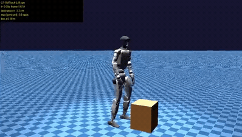
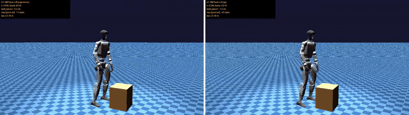

<h1 align="center">HUMANOID MIMIC</h1>


<p align="center">
  
  
  
</p>

<p align="center">
  
  
</p>
<p align="center">
  <sub>
    Locomotion (<a href="assets/locomotion.mp4">mp4</a>) &nbsp;·&nbsp;
    Dual-arm lift (<a href="assets/ppo_lift.mp4">mp4</a>)
  </sub>
</p>
<p align="center">
  
</p>
<p align="center">
  <sub>
    Box lift by motion tracking: SuperMimic (left, iteration 12000) and PPO-Sim (right,
    iteration 6000) (<a href="assets/supermimic_vs_ppo_lift.mp4">mp4</a>)
  </sub>
</p>

-------

**humanoid-mimic** trains Unitree G1 policies in MuJoCo with
[mjlab](https://github.com/mujocolab/mjlab). It has two learning stacks:

- **AMP-PPO:** RSL-RL PPO with an
  [Adversarial Motion Prior](https://arxiv.org/abs/2104.02180), for velocity-tracking
  locomotion and a bimanual dual-arm lift.
- **SuperMimic:** a reimplementation of
  [SuperMimic](https://arxiv.org/abs/2610.28480), which learns a differentiable world model
  and trains the policy through it with short-horizon analytic gradients. It is compared with
  the paper's PPO-Sim baseline on shared motion-tracking tasks: walking, squatting, and
  picking up a box.

## Installation

This repo is developed with [uv](https://docs.astral.sh/uv/).

```bash
curl -LsSf https://astral.sh/uv/install.sh | sh

git clone https://github.com/shuayyy/humanoid-mimic.git
cd humanoid-mimic

uv sync
```

Requires Python 3.12 or 3.13 and a CUDA-capable GPU.

-------

## Quickstart

Train the dual-arm task:

```bash
PYTHONPATH=src uv run python src/mjlab_g1/scripts/train.py \
  Mjlab-G1-DualArm --video False
```

Play a released policy:

```bash
PYTHONPATH=src uv run python src/mjlab_g1/scripts/play.py \
  Mjlab-G1-DualArm --checkpoint-file models/dualarm.pt
```

Train locomotion:

```bash
PYTHONPATH=src uv run python src/mjlab_g1/scripts/train.py \
  Mjlab-G1-Locomotion --video False
```

Train SuperMimic on the box lift, or the PPO-Sim baseline with `--learner ppo`:

```bash
PYTHONPATH=src uv run python src/mjlab_g1/scripts/train_track.py \
  G1-SMTrack-Lift --learner supermimic --start-uniform-mix 0.5
```

Evaluate a tracking checkpoint over 64 randomized episodes (domain randomization, observation
noise and reset noise):

```bash
PYTHONPATH=src uv run python src/mjlab_g1/scripts/eval_track.py \
  --task G1-SMTrack-Lift --learner supermimic \
  --checkpoint <model.pt> --episodes 64 --randomize
```

-------

## Tasks

| Task ID | Description | Policy | AMP clips |
| --- | --- | --- | --- |
| `Mjlab-G1-Locomotion` | Velocity-tracking locomotion | `models/locomotion.pt` | `dataset/locomotion` |
| `Mjlab-G1-DualArm` | Bimanual box lift | `models/dualarm.pt` | `dataset/dualarm` |

Motion clips are `[frames, 36]` arrays of MuJoCo `qpos`: root position and
quaternion followed by the 29 joints in model order.

Motion-tracking tasks (SuperMimic and PPO-Sim share one env, built on mjlab's G1 tracking task):

| Task ID | Description | Reference clip |
| --- | --- | --- |
| `G1-SMTrack-Walk` | Track a walking clip | `dataset/tracking/locomotion1.npz` |
| `G1-SMTrack-Squat` | Track the lift motion without a box | `dataset/tracking/dual_arm1.npz` |
| `G1-SMTrack-Lift` | Track the lift motion and pick up a 1.5 kg box | `dataset/tracking/dual_arm1_box.npz` |

The tracking clips are the AMP clips converted to mjlab's 50 Hz format
(`convert_motion.py`; the dual-arm mocap is treated as a 20 fps capture). The lift clip adds a
0.30 × 0.32 × 0.36 m box reference that follows the palms after the grasp
(`make_box_reference.py`).

-------

## SuperMimic results

Box lift, randomized evaluation (64 episodes, every episode from the first frame). Success
means the box is within 10 cm of its reference height at the clip end.

| Learner | Env steps | Lift success |
| --- | --- | --- |
| SuperMimic (2 seeds) | 20 M | 97–98 % |
| SuperMimic (2 seeds) | 31 M | 100 % |
| PPO-Sim (2 seeds) | 491 M | 94–97 % |

Both learners use the 50/50 uniform/adaptive start sampling (`--start-uniform-mix 0.5`). These
SuperMimic numbers were measured with clean observations; the evaluation now adds the same
observation noise for both learners, and these checkpoints have not been re-evaluated with it.

The full tables (walk, squat, lift, start-sampling variants and checkpoint variance), the
setup and the evaluation caveats are in
[`docs/supermimic/RESULTS.md`](docs/supermimic/RESULTS.md). How the implementation maps to the
paper is in [`docs/supermimic/paper_fidelity.md`](docs/supermimic/paper_fidelity.md).

-------

## Repository layout

| Path | Contents |
| --- | --- |
| `src/mjlab_g1/envs/` | Task environments, including the dual-arm RL env and the tracking env |
| `src/mjlab_g1/tasks/` | Task configs, MDP terms (rewards, observations), registry |
| `src/mjlab_g1/rl/supermimic/` | SuperMimic: world model, imagination, replay, actor-critic, analytic reward |
| `src/mjlab_g1/assets/` | G1 and object models |
| `rsl_rl/` | RSL-RL 5.2 with AMP-PPO migrated in |
| `dataset/` | AMP motion clips; `dataset/tracking/` holds the tracking clips |
| `scripts/` | Slurm training, evaluation and render launchers |
| `models/` | Released policies |
| `docs/supermimic/` | SuperMimic design notes, paper audit and results |
| `tests/supermimic/` | Tests for the SuperMimic learner and the tracking env |

-------

## Evaluation

Render a checkpoint:

```bash
PYTHONPATH=src uv run python src/mjlab_g1/scripts/render_video.py \
  Mjlab-G1-DualArm \
  --checkpoint-file <checkpoint.pt> \
  --output-dir models/videos/<name>
```

Render a tracking checkpoint (ray-traced, no OpenGL needed):

```bash
PYTHONPATH=src uv run python src/mjlab_g1/scripts/render_track.py \
  --task G1-SMTrack-Lift --learner supermimic \
  --checkpoint <model.pt> --output <video.mp4>
```

For Slurm, use the launchers in `scripts/`: `train_slurm.sbatch` (AMP-PPO),
`train_track.sbatch` (SuperMimic / PPO-Sim) and `render_compare.sbatch` (side-by-side videos).


-------

## Citation

If you use this code, please cite the methods it builds on:

```bibtex
@article{peng2021amp,
  title   = {AMP: Adversarial Motion Priors for Stylized Physics-Based Character Control},
  author  = {Peng, Xue Bin and Ma, Ze and Abbeel, Pieter and Levine, Sergey and Kanazawa, Angjoo},
  journal = {ACM Transactions on Graphics},
  volume  = {40},
  number  = {4},
  year    = {2021}
}

@article{liao2026supermimic,
  title   = {SuperMimic: Scaling Humanoid Whole-Body Control with One Differentiable World Model},
  author  = {Liao, Qiayuan and Shao, Yiyang and Long, Junfeng and Zakka, Kevin and Horowitz, Roberto and Abbeel, Pieter and Sreenath, Koushil},
  journal = {arXiv preprint arXiv:2610.28480},
  year    = {2026}
}

@article{zhao2025resmimic,
  title   = {ResMimic: From General Motion Tracking to Humanoid Whole-body Loco-Manipulation via Residual Learning},
  author  = {Zhao, Siheng and Ze, Yanjie and Wang, Yue and Liu, C. Karen and Abbeel, Pieter and Shi, Guanya and Duan, Rocky},
  journal = {arXiv preprint arXiv:2510.05070},
  year    = {2025}
}

@article{han2026husky,
  title   = {HUSKY: Humanoid Skateboarding System via Physics-Aware Whole-Body Control},
  author  = {Han, Jinrui and Wang, Dewei and Zhang, Chenyun and Liu, Xinzhe and Luo, Ping and Bai, Chenjia and Li, Xuelong},
  journal = {arXiv preprint arXiv:2602.03205},
  year    = {2026}
}
```

## Acknowledgments

Built on [mjlab](https://github.com/mujocolab/mjlab) and
[RSL-RL](https://github.com/leggedrobotics/rsl_rl). Licensed under Apache-2.0.
