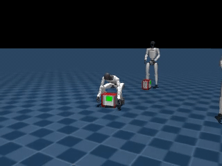

<h1 align="center">HUMANOID AMP PPO</h1>


<p align="center">
  
  
  
</p>

<p align="center">
  
  
</p>
<p align="center">
  <sub>
    Locomotion (<a href="assets/locomotion.mp4">mp4</a>) &nbsp;·&nbsp;
    Dual-arm lift (<a href="assets/dual_arm.mp4">mp4</a>)
  </sub>
</p>

-------

**humanoid-amp-ppo** trains Unitree G1 policies in MuJoCo with
[mjlab](https://github.com/mujocolab/mjlab), RSL-RL PPO, and an
[Adversarial Motion Prior](https://arxiv.org/abs/2104.02180). The repo has two
tasks: velocity-tracking locomotion and a bimanual dual-arm lift.

## Installation

This repo is developed with [uv](https://docs.astral.sh/uv/).

```bash
curl -LsSf https://astral.sh/uv/install.sh | sh

git clone https://github.com/shuayyy/humanoid-amp-ppo.git
cd humanoid-amp-ppo

uv sync
```

Requires Python 3.12 or 3.13 and a CUDA-capable GPU.

-------

## Quickstart

Train the dual-arm task:

```bash
PYTHONPATH=src uv run python src/mjlab_g1/scripts/train.py \
  Mjlab-G1-DualArm --video False
```

Play a released policy:

```bash
PYTHONPATH=src uv run python src/mjlab_g1/scripts/play.py \
  Mjlab-G1-DualArm --checkpoint-file models/dualarm.pt
```

Train locomotion:

```bash
PYTHONPATH=src uv run python src/mjlab_g1/scripts/train.py \
  Mjlab-G1-Locomotion --video False
```

-------

## Tasks

| Task ID | Description | Policy | AMP clips |
| --- | --- | --- | --- |
| `Mjlab-G1-Locomotion` | Velocity-tracking locomotion | `models/locomotion.pt` | `dataset/locomotion` |
| `Mjlab-G1-DualArm` | Bimanual box lift | `models/dualarm.pt` | `dataset/dualarm` |

Motion clips are `[frames, 36]` arrays of MuJoCo `qpos`: root position and
quaternion followed by the 29 joints in model order.

-------

## Repository layout

| Path | Contents |
| --- | --- |
| `src/mjlab_g1/envs/` | Task environments, including the dual-arm RL env |
| `src/mjlab_g1/tasks/` | Task configs, MDP terms (rewards, observations), registry |
| `src/mjlab_g1/assets/` | G1 and object models |
| `rsl_rl/` | RSL-RL 5.2 with AMP-PPO migrated in |
| `dataset/` | AMP motion clips |
| `scripts/` | Slurm training launcher |
| `models/` | Released policies |

-------

## Evaluation

Render a checkpoint:

```bash
PYTHONPATH=src uv run python src/mjlab_g1/scripts/render_video.py \
  Mjlab-G1-DualArm \
  --checkpoint-file <checkpoint.pt> \
  --output-dir models/videos/<name>
```

For Slurm, use the launcher in `scripts/train_slurm.sbatch`.


-------

## Citation

If you use this code, please cite the methods it builds on:

```bibtex
@article{peng2021amp,
  title   = {AMP: Adversarial Motion Priors for Stylized Physics-Based Character Control},
  author  = {Peng, Xue Bin and Ma, Ze and Abbeel, Pieter and Levine, Sergey and Kanazawa, Angjoo},
  journal = {ACM Transactions on Graphics},
  volume  = {40},
  number  = {4},
  year    = {2021}
}

@article{zhao2025resmimic,
  title   = {ResMimic: From General Motion Tracking to Humanoid Whole-body Loco-Manipulation via Residual Learning},
  author  = {Zhao, Siheng and Ze, Yanjie and Wang, Yue and Liu, C. Karen and Abbeel, Pieter and Shi, Guanya and Duan, Rocky},
  journal = {arXiv preprint arXiv:2510.05070},
  year    = {2025}
}

@article{han2026husky,
  title   = {HUSKY: Humanoid Skateboarding System via Physics-Aware Whole-Body Control},
  author  = {Han, Jinrui and Wang, Dewei and Zhang, Chenyun and Liu, Xinzhe and Luo, Ping and Bai, Chenjia and Li, Xuelong},
  journal = {arXiv preprint arXiv:2602.03205},
  year    = {2026}
}
```

## Acknowledgments

Built on [mjlab](https://github.com/mujocolab/mjlab) and
[RSL-RL](https://github.com/leggedrobotics/rsl_rl). Licensed under Apache-2.0.
